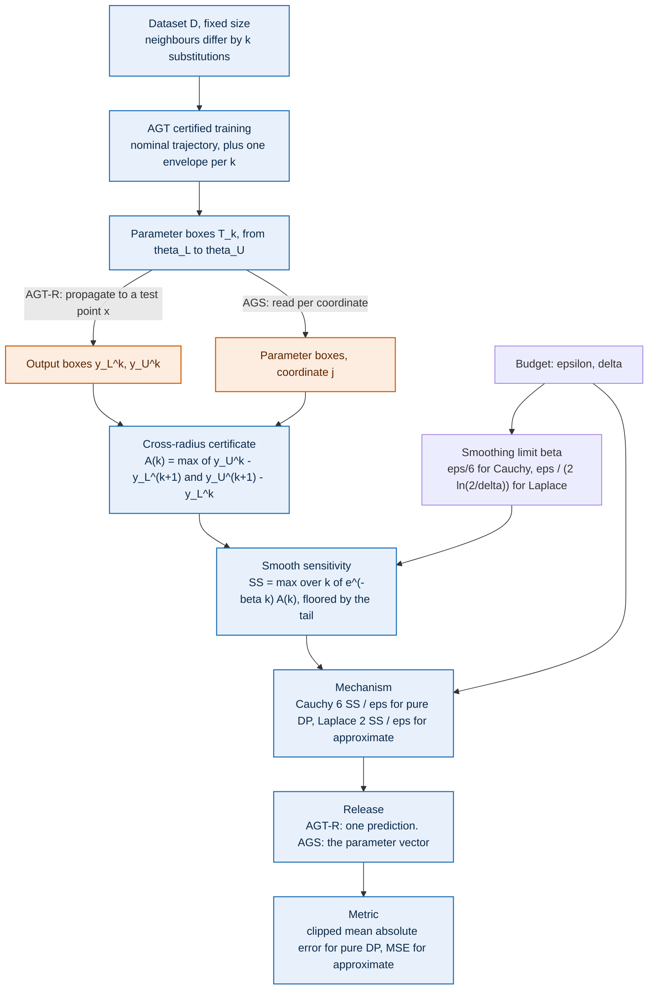

# Abstract Gradient Training — private prediction and private learning

This repository holds the experimental work behind two mechanisms built on **Abstract Gradient
Training (AGT)**, plus the AGT packages themselves:

- **AGT-R** — private *prediction* for regression. Noise calibrated to a certified upper bound on
  the smooth sensitivity of a prediction, so a non-privately trained regressor can answer queries
  under differential privacy.
- **AGS** (Abstract Gradient Sampling) — private *learning*. The same certificate applied in
  parameter space, so the released model itself is differentially private.

Both rest on AGT's parameter envelopes: bounds containing every parameter vector reachable by
training on any dataset within `k` substitutions of the observed one.

## How it works

Both methods are the same pipeline, and differ in one place: which space the certified envelope is
read in. AGT-R propagates it to the model's output at a test point and privatises a prediction; AGS
uses it directly in parameter space and privatises the model.




## Layout

| path | contents |
|---|---|
| `abstract_gradient_training/` | AGT package: interval (IBP) and CROWN bound propagation, certified training |
| `abstract_gradient_training_opt/` | AGT package: Gurobi-unrolled (LP/QP/MILP/MIQCP) certified training |
| `tests/` | package tests |
| `common/` | shared experiment code: `ags.py` (AGS core), `baselines.py` (DP-SGD, functional mechanism, sharding, PATE), `plotting.py`, `figures.py`, `sensitivity.py`, `privacy.py`, `training.py` |
| `common/accounting/` | cross-radius sensitivity, DP accountants (exact, PLD, RDP), calibration, amplification; own test suite |
| `agtr/` | AGT-R experiments: `linear/` and `california/`, each `certify.py` then `train.py` -> `release.py` -> `plot.py` over stored bounds in `values/`; `pate/` holds the matched PATE-R comparison, `probes/` the finished one-offs, `condition_table.py` the feasibility figure |
| `ags/` | AGS experiments, one directory per dataset with the study beneath it: `blobs/` and `mnist/` (certified envelopes, `plot_*.py` per paper figure, `accounting/` with its artifacts), `imdb/` and `adult/` (the contractive comparison and the sampling ablation), `agt_ext/`, and `accounting/` for the few things that belong to no dataset; figures are PNG only |
| `agtr/legacy/`, `ags/legacy/` | superseded drivers, kept runnable so their figures stay reproducible; each carries a banner naming what replaced it |
| `ags/README.md`, `agtr/README.md` | one per tree: the settings, the drivers, and the cautions specific to that half of the work |
| `CONVENTIONS.md` | where new work goes, how it is named, what must not change, and how a change is verified |
| `tools/` | `reproduce_figures.py`, the gate that reruns every figure producer and compares against a recorded baseline |

## How things are named

`CONVENTIONS.md` is the rulebook: one directory per dataset with the study beneath it, a verb on every
script (`certify.py train.py release.py plot.py`, otherwise `run_*` and `plot_*`), where outputs go
and why they are never overwritten, and how a change is verified. In code, `A[k]` is the cross-radius certificate, `W[k]` an envelope width, `SS`
the smooth sensitivity, `GS` the global sensitivity. Width and radius were once the same name, which
is how the width-versus-radius defect survived as long as it did.

## Running things

Everything runs from the repository root with the root on `PYTHONPATH`:

```bash
PYTHONPATH=. python -m ags.blobs.plot_headline
PYTHONPATH=. python -m agtr.california.release --variant relu_h64_clamp_gamma0.1 --plot-only
```

Figures have one entry point, which dispatches to the named builders and to each experiment's own
script:

```bash
PYTHONPATH=. python -m common.figures            # lists every figure name
PYTHONPATH=. python -m common.figures blobs_headline
PYTHONPATH=. python -m common.figures pate_linear --tag exact_n40000_e20_lr0.3_g1 --plot-only
```

Tests:

```bash
pytest tests/                                    # the two AGT packages
PYTHONPATH=. pytest -q common/accounting/tests \
    ags/blobs/test_ss_reference.py ags/mnist/test_ss_reference.py \
    ags/agt_ext/test_deep_per_sample.py          # accounting, release bit-equality, extensions
```

Every figure redraws from stored bounds with no solver present. Gurobi is needed only to compute
new certificates.

## Working with the AGT packages

Wrap a PyTorch model, configure, and train; the bounded model then carries `param_l`, `param_n`,
`param_u` and can propagate an input through the parameter envelope:

```python
import torch
import abstract_gradient_training as agt

model = torch.nn.Sequential(torch.nn.Linear(784, 128), torch.nn.ReLU(), torch.nn.Linear(128, 10))
bounded_model = agt.bounded_models.IntervalBoundedModel(model)
config = agt.AGTConfig(n_epochs=10, learning_rate=0.1, loss="cross_entropy",
                       k_private=1, clip_gamma=0.1)          # clip_gamma is required for privacy
agt.privacy_certified_training(bounded_model, config, dl_train, dl_val)

logits = bounded_model.forward(test_point)                   # nominal prediction
logits_l, logits_u = bounded_model.bound_forward(test_point) # certified output box
```

Three things bite in practice. Bounds are not floating-point sound, so use `torch.float64` and treat
any precision warning as an error. The batch size is fixed for the whole run and incomplete batches
are silently dropped. `fragsize` splits each batch for memory only and never changes the bound;
lower it on out-of-memory errors.

`common.training.train_certified` wraps all of this for new experiment drivers.
Every local change to the two packages is confined to `ags/agt_ext/` and `common/agt_patches.py`.

## References

The packages implement:

- [Certified Robustness to Data Poisoning in Gradient-Based Training](https://arxiv.org/pdf/2406.05670v1)
- [Certificates of Differential Privacy and Unlearning for Gradient-Based Training](https://arxiv.org/abs/2406.13433)


> **Anonymized artifact.** This is a history-free export of the working repository prepared for double-blind review. Internal working notes, raw certificate cells, solver model dumps and training logs are not included; every figure and table of the paper regenerates from the stored results with `PYTHONPATH=. python -m tools.reproduce_figures --check`.
